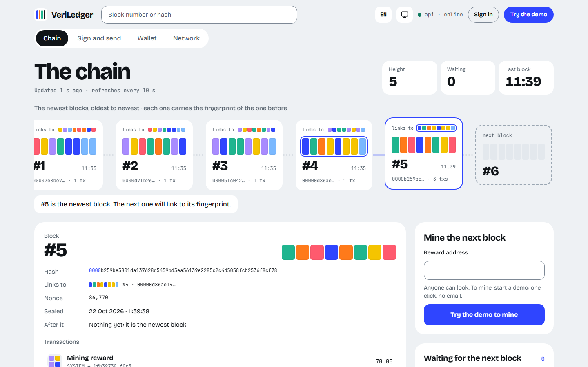
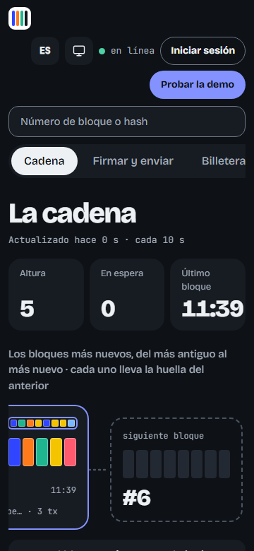
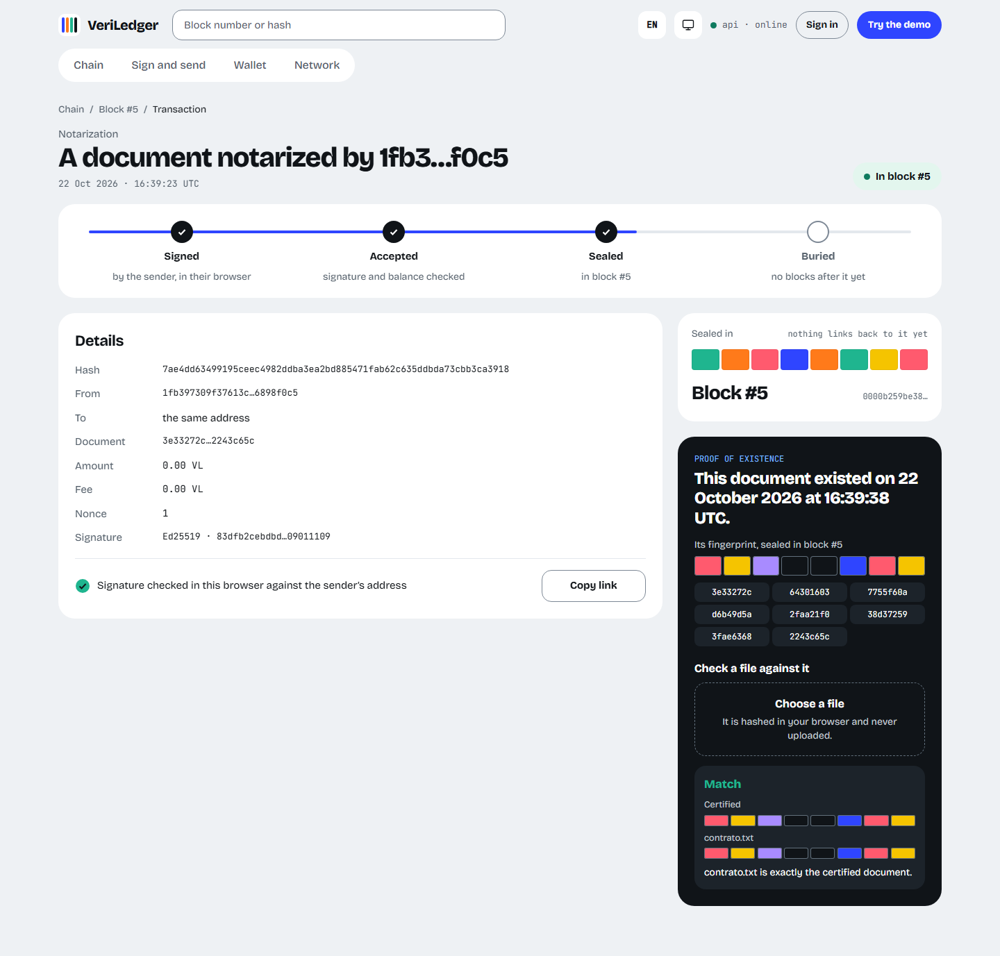
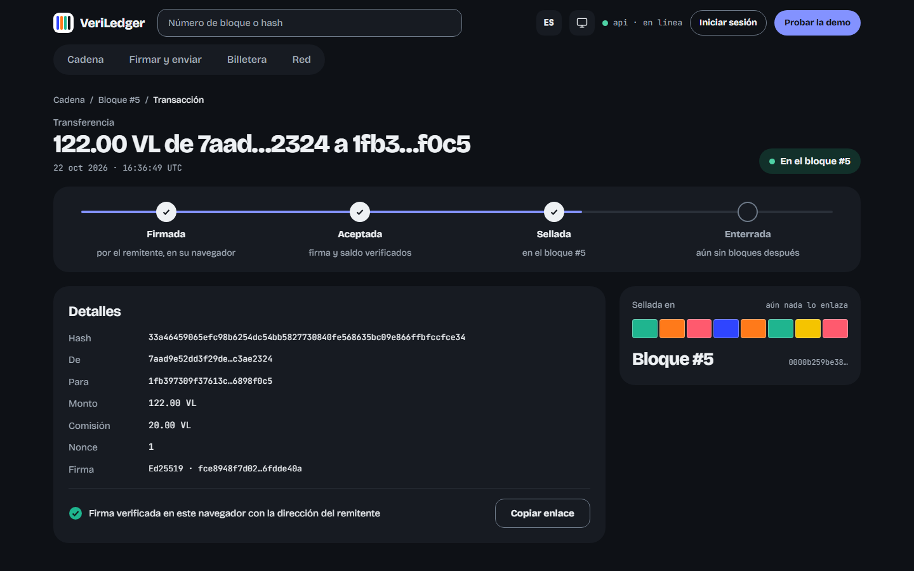
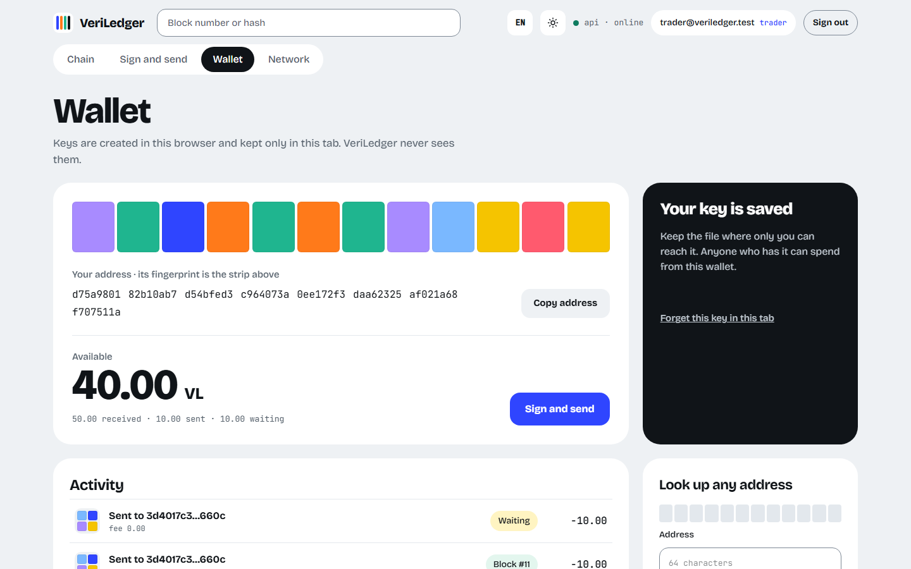
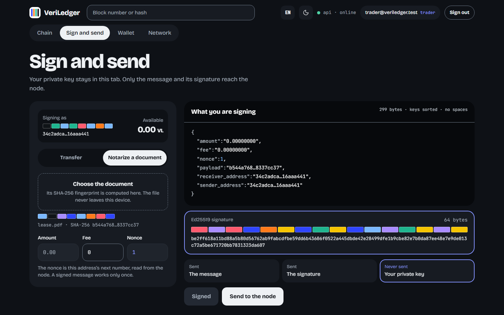

# VeriLedger

**A verifiable ledger you can try in your browser.**

Blockchains are usually explained, not shown. VeriLedger shows one in a few minutes, with nothing to install: a wallet whose private key only you hold, a transfer signed in your own browser, a block mined with your transaction in it, and a certificate that proves a document existed at a given moment.

This repository is the web app. Its engine is [veriledger-api](https://github.com/Alesso2805/veriledger-api), and both are deployed on one hostname.



## Try it

**Live demo: [veriledger.duckdns.org](https://veriledger.duckdns.org)**

Anyone can look around without an account: the chain, any transaction and the peers. **Try the demo** starts a 24-hour account with one click, with no email and no password.

What to try:

1. **Create a wallet.** The key pair is made in your browser and held only in the tab. Save its key file, since a reload forgets the key.
2. **Mine a block** to your address on **The chain**. It slides in at the right end of the ribbon, with its fingerprint and the fingerprint of the block it links to.
3. **Sign and send.** Transfer to any address, or notarize a document: the document is hashed in your browser, and only its fingerprint is sent. The page shows the exact message you sign.
4. **Mine again, then open your transaction.** Its journey from signed to buried, its signature checked in your browser and, for a notarization, its certificate. Check a file against it: the same file matches, and one changed character changes every bar of its fingerprint.
5. **Look around:** English or Spanish, light or dark, and a 360 px phone screen.



## Why it exists

A ledger is "verifiable" only if you can check it yourself. So VeriLedger checks in your browser, rather than asking you to trust the server:

- Your private key is created and used in the tab. It is never sent, and never stored.
- The message you sign is the API's canonical message, shown to you before you sign it.
- A transaction's signature is verified again in the browser when you open it.
- A certificate is checked by hashing your own file locally and comparing it with the chain.

It is a portfolio project, so every one of these claims is backed by a test.

## Highlights

- **The key never leaves the browser.** Keys are made with `@noble/curves` and held in memory for the tab. A test records every request of the create → transfer → notarize flow and finds no private key (AR-05).
- **Signatures the API accepts, byte for byte.** The signed message reproduces the API's golden vectors (AR-06), and a nonce per sender prevents replays. A 409 for a used nonce reads the next one and asks to sign again.
- **A chain you can see.** Every hash and address is drawn as a fingerprint: coloured bars, one per byte. Pointing at a block lights the fingerprint it links to, which is exactly the previous block's.
- **English and Spanish, light and dark.**
  - Texts come from typed dictionaries, so a missing translation fails the build.
  - The API's known errors are shown in the page's language.
  - The theme follows the system or your choice, and is set before the first paint.
- **Honest screens.** What is drawn comes from the API's answers, and nothing is animated that the API does not provide. A page that throws shows a fallback instead of going blank.
- **One image for any hostname.**
  - Static files are served by Caddy as a non-root user, with a strict Content Security Policy.
  - `/config.json` is written when the container starts.
  - Images are built for amd64 and arm64.

## Quality

- **Audited against its own documents.** On 2026-10-20 an audit compared the first version with its specification. 12 of the 18 architecture rules and engineering requirements it checked were not met, every transaction it signed was rejected by the API, and it did not build from a clean clone. Every blocking and important finding became a story, and all of them are done. A second audit, on 2026-10-21, looked for anything that could blank a page (VLW-35, VLW-36).
- **Architecture rules that fail the build.** The 11 rules of [docs/ARCHITECTURE_RULES.md](docs/ARCHITECTURE_RULES.md) each name the test that checks them:
  - imports point inward;
  - axios only in `services`, and `@noble` only in `lib`;
  - no private key in any request, and the API's signing vectors;
  - no API URL in the bundle, and a guard on every route;
  - API types generated from its OpenAPI document;
  - the design tokens, character for character;
  - no English on a page drawn in Spanish.
- **Tests:**
  - 399 unit and component tests, with axe in the component tests;
  - 84 checks in a real browser at 1280 and 360 px, in the light theme in English and the dark theme in Spanish. They look for accessibility violations, sideways scroll and invisible focus. They also feed every field, route, file and stored value odd input, and check that no page throws;
  - the main flows end to end against the API's published image, and again behind its production Caddy, where any Content Security Policy violation fails the run.

## Architecture

```mermaid
flowchart LR
  P[Person] --> B[Browser: React app]
  B ---|signs here| K[(Key pair, in the tab's memory)]
  B -->|"/" static files · "/api" REST + JWT| C[Caddy, one hostname]
  C --> W[veriledger-webapp image]
  C --> A[veriledger-api: FastAPI]
  A --> D[(PostgreSQL)]
  A <-->|longest valid chain| N[Peer nodes]
```

**Stack:**
- **Framework:** React 19, TypeScript (strict), Vite 8, React Router 7, Zustand 5 and axios.
- **Design:** Tailwind CSS 4, with Bricolage Grotesque and JetBrains Mono.
- **Keys and signing:** `@noble/curves` (Ed25519).
- **Checks:** Vitest, Testing Library, Playwright, axe-core, dependency-cruiser, oxlint, and types generated from the API's OpenAPI document.
- **Serving:** a Caddy image on a non-root user.

**Documentation:**
- [docs/SPEC.md](docs/SPEC.md): what the app does, its architecture, the API it uses, the signing contract and how each requirement is verified.
- [docs/DESIGN.md](docs/DESIGN.md): design C, its tokens in both themes, its motion and every view.
- [docs/BACKLOG.md](docs/BACKLOG.md): the stories and the sprint plan. [docs/sprints/](docs/sprints/): what each sprint delivered.
- [docs/adr/](docs/adr/): one decision per file.
- [CHANGELOG.md](CHANGELOG.md): what changes, release by release.

| | |
| --- | --- |
|  |  |
|  |  |

## Run it locally

You need:
- Node.js 22.13 or later. `nvm use` reads `.nvmrc`.
- The API running on `http://127.0.0.1:8000`: `docker compose up` in [veriledger-api](https://github.com/Alesso2805/veriledger-api#run-it).

```bash
npm ci
npm run dev        # http://localhost:5173
```

The app calls the API at `VITE_API_URL`, which `.env.development` sets to `http://127.0.0.1:8000`. If your API runs elsewhere, put another value in `.env.development.local`. In development the admin is `admin@veriledger.com` with the password the API's README gives.

### Development

```bash
npm run lint       # oxlint, no warnings allowed
npm run lint:arch  # the import rules (dependency-cruiser)
npm test           # Vitest
npm run build      # tsc -b and vite build
npm run test:a11y  # the browser checks: npx playwright install chromium first
npm run test:e2e   # the main flows, against the API's stack (E2E_ADMIN_EMAIL, E2E_ADMIN_PASSWORD)
npm run types:api  # regenerate src/types/api.ts from the API's OpenAPI document
```

To put it on a server, follow the API's [deploy runbook](https://github.com/Alesso2805/veriledger-api/blob/main/docs/runbooks/deploy.md): one Caddy serves this image at `/` and the API at `/api`.

| Folder | Contents |
| --- | --- |
| `src/pages` | One component per route |
| `src/components` | The shell and each view's pieces |
| `src/lib` | Pure logic: signing, keys, fingerprints, formats and the two dictionaries |
| `src/services` | The API client |
| `src/store` | Session, key, preferences and toasts |
| `src/architecture` | The tests of the architecture rules |
| `e2e/` | Browser checks and end-to-end flows with Playwright |
| `docker/` | The Caddyfile, the config script and the image's smoke test |
| `docs/` | Specification, design, backlog, ADRs and sprint notes |

## About

Built by [Alessandro David](https://github.com/Alesso2805) as a portfolio project: specification, design, web app, API and deployment, in two-week sprints. The webapp's stories are `VLW-NN` and the API's are `VLA-NN`.

Found a security issue? See [SECURITY.md](SECURITY.md). Licensed under the [MIT License](LICENSE).
